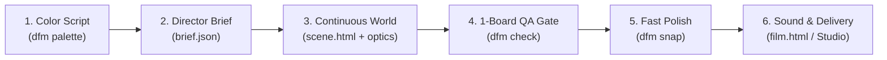
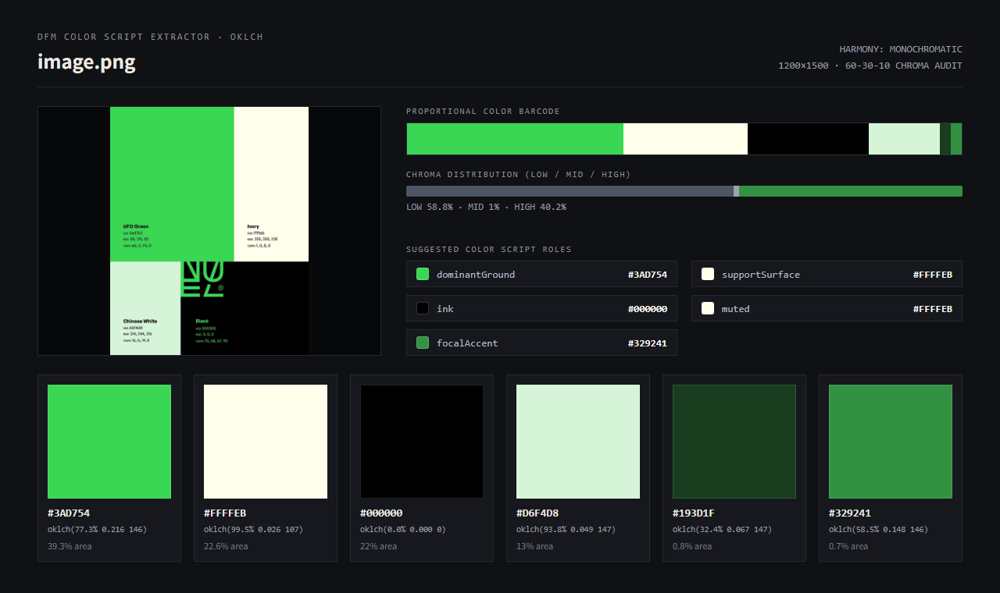
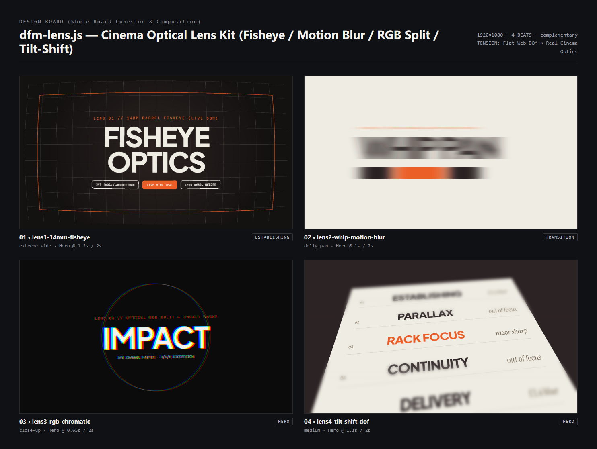
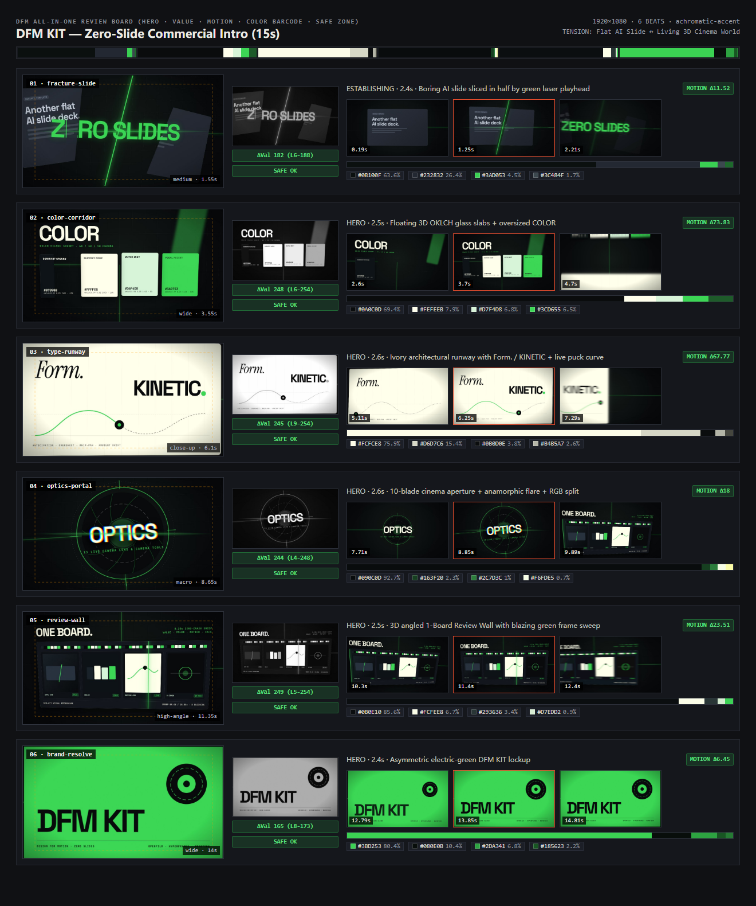
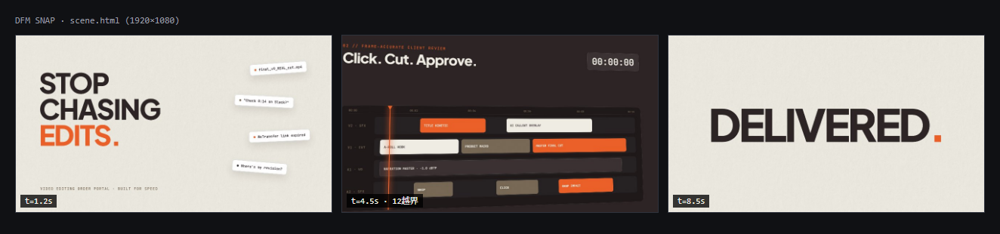

# dfm-kit

**English** | [简体中文](./README.zh-CN.md)

**A fast, style-agnostic Design-for-Motion director toolkit, OKLCH Color Script engine, 13-API cinema optical lens kit, and 1-board visual microscope for programmatic video.**

> **Core Philosophy**: Give 100% of visual style freedom back to your story and creative direction — 2D vector, Canvas illustration, WebGL, 3D spatial camera, archival print collage, or kinetic typography. Zero fixed visual templates, zero style lock-in, and zero `npm install` dependencies.

---

## How It Works — The 6-Step DFM Pipeline

`dfm-kit` replaces trial-and-error slide generation with a deterministic, visual-feedback **6-step Design-for-Motion loop**:



### Step 1 · Color Script Extraction (`dfm palette`)
Drop **any reference color card, poster, or film still** and run `node cli/dfm.mjs palette <image>`.
`dfm-kit` quantizes real pixel area proportions in perceptual **OKLCH** space and outputs a visual swatch card (`*-palette.png`), structured JSON roles (`*-palette.json`), and drop-in CSS variables (`*-theme.css`) — locking in a disciplined **60-30-10 chroma budget** before a single pixel of the video is drawn.



### Step 2 · Style-Free Director Brief (`brief.json`)
Before writing HTML, the agent commits to a concise `brief.json` declaring:
- **Concept Tension Pair** (e.g., *Enclosed Cabin <-> Expanded Field of View*, *Competing Demands <-> Uninterrupted Thought*)
- **Spatial Architecture** (`continuous-world-camera`, `hero-morph`, `portal-match-cut`, `kinetic-typography`, or `tactile-collage`)
- **OKLCH Color Script & Curated Google Fonts Casting** (`spec/fonts.json`)
- **Concrete Per-Beat Physical Transitions (`transitionOut`)** — specifying how each beat physically leads into the next instead of fading to blank slides.

### Step 3 · Continuous-World Staging & Cinema Optics (`scene.html` + `runtime/`)
All beats live inside **one continuous spatial world** (driven by `createWorldCamera()` in `runtime/dfm-motion.js` or a persistent morphing canvas — never isolated `display: none` slide boxes).
Guided by **Truth to Medium**, surfaces stay crisp, matte, and architectural (zero cheap faux-3D CSS gradients), enhanced on demand with physical motion primitives (`anticipationPop`, `whipPan`, `portalZoom`, `ambientDrift`) and **13 live DOM/SVG optical lenses** in `runtime/dfm-lens.js`:



### Step 4 · 1-Board Fast Visual Microscope & Automated QA (`dfm check`)
In **~2–8 seconds**, `dfm check` renders **sharp, high-density review boards** (`review-board.png`; films longer than 6 beats are auto-paginated into `review-board-1.png`, `-2.png`… so every frame stays crisp for vision models) combining Hero frames, Grayscale Value separation (`ΔVal`), 3-frame Motion Strips (`MOTION Δ`), whole-film & per-shot Movie Color Barcodes, and Safe-Zone overlays (pass `--full` for 5 standalone HD boards).

At the same time, **`dfm audit`** runs **Q1–Q16 automated QA** — including a **0.25s full-timeline zero-crash sweep** of `frame(t)`, **platform-aware vertical safe zones** (`social-strict` for TikTok/Reels/Douyin/Xiaohongshu with ghost UI overlay, `shorts` for YouTube Shorts, `clean` for 16:9), anti-slide DOM architecture detection, **visual layout-repetition detection** (flags one template re-skinned across many beats), Truth-to-Medium faux-3D/gradient checks, a **custom-font guard**, **blank-opening-frame detection** (any solid color), Pure Cinema Frame checks, single-track `.vtt` caption collision checks (JS strings and static HTML), and `<audio>` track verification. Agents are instructed to polish until `BLOCKER=0` and `FIX=0`:



### Step 5 · 1–2s Targeted Frame Polish (`dfm snap`)
After tweaking a specific beat, run `node cli/dfm.mjs snap scene.html 1.2,4.5,8.5` to inspect exact timestamps and safe-zone geometry in **~1 second** without re-rendering the whole film:



### Step 6 · Sound Design & Studio Delivery (`film.html` / `dfm to-openfilm`)
Assemble frame-synced SFX (`whoosh`, `impact`, `latch`) and restrained music tracks via OpenFilm's native CC0 audio library on dedicated `<section>` tracks in `film.html`, verify with `dfm check`, and play back natively in OpenFilm Studio (or sync external projects via `dfm to-openfilm`).

---

## Renderer Support

`dfm-kit` is designed as a **renderer-agnostic craft & QA layer** for AI-assisted programmatic motion design:

| Target Engine | Status | Notes |
| :--- | :--- | :--- |
| **[OpenFilm](https://openfilm.dev)** | **Supported (Built-in)** | Deterministic `window.film.frame(t)`, `dfm to-openfilm`, Studio skill installer & native CC0 audio workflow |
| **Hyperframes** | **Planned** | Renderer adapter & deterministic timeline bridge |
| **Remotion** | **Planned** | React composition frame inspector & Q1–Q16 visual QA adapter |

---

## Quick Start

### Requirements
- **Node.js >= 22** (uses built-in `WebSocket` and `http` — **zero `npm install`**)
- **Google Chrome** or **Microsoft Edge** (headless CDP rendering; override path with `DFM_BROWSER`)
- **FFmpeg** (optional — only needed for `dfm preview` or `cli/textures-prep.mjs`)

### 1. Clone & Install the Skill (1 Command)
```bash
git clone https://github.com/Ph0enixHan/dfm-kit.git
cd dfm-kit
node cli/dfm.mjs install-skill
```
This installs `skill/SKILL.md` into your OpenFilm Studio `Skills/dfm-kit/` folder (override destination via `DFM_OPENFILM_SKILLS` or pass any agent skills directory as an argument), binds `<DFM_ROOT>` to your local clone automatically, and — if you keep real scan textures in `textures/web/` — inlines a catalog of them into the installed skill so the agent can use them without browsing folders.

### 2. Direct a Video with Your AI Agent
Invoke the `dfm-kit` skill and describe your video (or even give a single sentence, optionally with a reference color card or film still). The agent automatically executes the 6-step DFM pipeline end-to-end.

---

## CLI Reference

| Command | Description |
| :--- | :--- |
| `node cli/dfm.mjs check <dir> [--full]` | Render fast 1-board `review-board.png` + 0.25s full-timeline crash sweep + Q1–Q16 QA (`--full` outputs 5 standalone HD boards) |
| `node cli/dfm.mjs snap <htmlFile> <t1,t2,...>` | 1–2s single/multi-frame inspector (`dfm-out/snap.png` + safe-zone clipping stats) |
| `node cli/dfm.mjs palette <image> [outDir]` | Extract OKLCH Color Script, visual swatch card PNG, JSON & CSS theme variables |
| `node cli/dfm.mjs install-skill [skillsDir]` | Install `dfm-kit` skill into OpenFilm Studio (or any skills dir) with your local repo path |
| `node cli/dfm.mjs to-openfilm <dir> [name]` | Package an external project and sync into OpenFilm Studio `Projects/` |
| `node cli/dfm.mjs preview <dir>` | Render a deterministic 30fps H.264 MP4 preview (for headless CLI outside Studio) |
| `node cli/dfm.mjs audit <dir>` | Run Q1–Q16 QA audit without re-rendering boards |
| `node cli/dfm.mjs init <newDir>` | Scaffold a clean, style-agnostic `brief.json` starter |

---

## Repository Structure

```text
dfm-kit/
├── cli/
│   ├── dfm.mjs              # Main CLI entry
│   ├── board.mjs            # Fast 1-board review renderer + optional 5 HD boards + 0.25s crash sweep
│   ├── audit.mjs            # Style-agnostic Q1-Q16 QA auditor (anti-slide, Truth-to-Medium, VTT & audio gates)
│   ├── snap.mjs             # 1-2s targeted frame inspector
│   ├── palette.mjs          # OKLCH Color Script extractor from any reference image
│   ├── color-math.mjs       # sRGB <-> OKLCH color math & filmic role assignment
│   ├── cdp-browser.mjs      # Zero-dependency headless Chrome/Edge CDP driver with persistent HTTP cache
│   ├── openfilm-sync.mjs    # OpenFilm Studio draft packager & sync adapter
│   ├── install-skill.mjs    # 1-command skill installer
│   ├── preview.mjs          # Deterministic 30fps MP4 exporter (headless CLI)
│   └── textures-prep.mjs    # Optional <=1200px proxy baker for your local CC0 texture packs
├── runtime/                 # Optional zero-dependency browser modules (copy on demand)
│   ├── dfm-motion.js        # Continuous 3D world camera, radial rig & reveal choreography
│   ├── dfm-time.js          # Deterministic clamped easings & physical motion primitives
│   ├── dfm-lens.js          # 13-API cinema optical lens & camera rig
│   ├── dfm-craft.css        # Procedural grain, halftone, halation, paper fiber, vignette
│   └── dfm-stage.css        # Optional multi-plane stage helpers
├── spec/
│   ├── brief.schema.json    # Style-agnostic Director Brief schema
│   ├── rubric.json          # Universal Q1-Q16 Production QA Rubric
│   ├── fonts.json           # Curated Google Fonts casting pairings
│   └── continuity-grammar.json # Non-slide spatial & visual continuity grammar
├── skill/
│   └── SKILL.md             # Portable agent director skill
├── docs/images/             # Verified workflow & real-case screenshots
└── textures/
    └── README.md            # Guide for optional local CC0 tactile texture packs
```

---

## Optional Local Tactile Textures

Procedural textures in `runtime/dfm-craft.css` work out of the box with zero assets. If you want real scanned paper, 35mm film frames, or analog halftones, drop your own CC0 packs into `textures/` and run `node cli/textures-prep.mjs` to bake lightweight `<=1200px` proxies into `textures/web/` (see [textures/README.md](./textures/README.md)).

## License

[MIT](./LICENSE)
