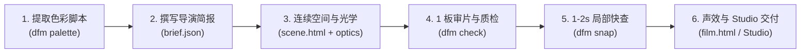
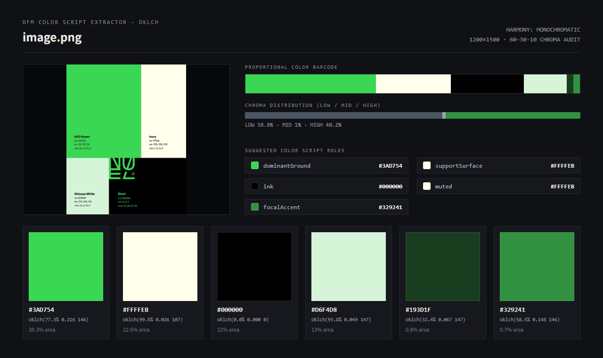
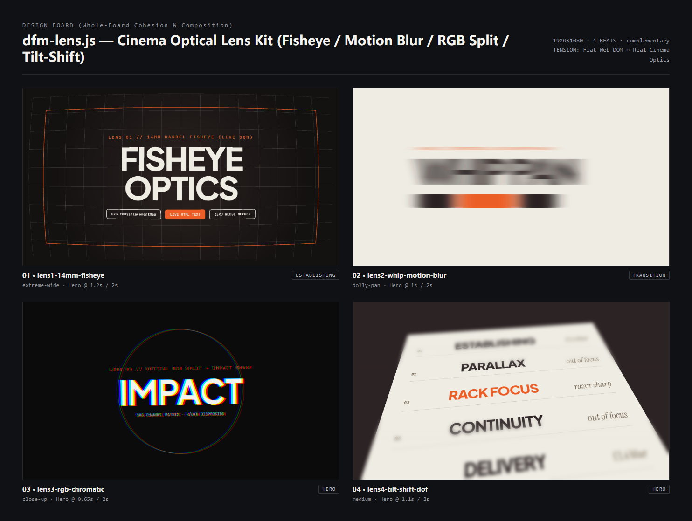
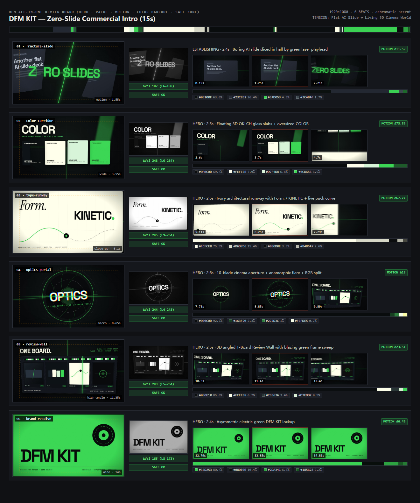
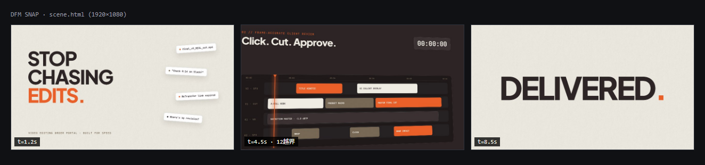

# dfm-kit

[English](./README.md) | **简体中文**

**面向代码驱动视频的零风格预设 Design-for-Motion 导演工具箱：OKLCH 色彩脚本引擎、13 组电影光学镜头箱、极速单板视觉显微镜与全时间轴防崩溃质检。**

> **核心理念**：把“画什么风格”的自由 100% 还给内容和创作者（2D 矢量、Canvas 手绘、WebGL、3D 空间运镜、印刷拼贴或动态排版统统不限）。零固定视觉模板、零风格锁死、零 `npm install` 外部依赖。

---

## 工作原理 — DFM 6 步导演闭环（How It Works）

`dfm-kit` 用一套确定性、可视化的 **6 步动态设计导演闭环**，取代盲抽式的 PPT 幻灯片生成：



### 第 1 步 · 放入参考色卡/剧照，提取 OKLCH 色彩脚本（`dfm palette`）
用户只要附带**任意一张色卡、海报或电影剧照**，运行 `node cli/dfm.mjs palette <图片>`，工具会在感知均匀的 **OKLCH** 空间统计真实面积占比，自动输出**视觉色卡图（`*-palette.png`）**、角色脚本（`*-palette.json`）与可直接引用的 CSS 变量（`*-theme.css`），在动笔写第一行画面代码前就锁定克制的 **60-30-10 色度预算**：



### 第 2 步 · 撰写零模板导演简报（`brief.json`）
写代码前先在 `brief.json` 定清整部片子的导演骨架：
- **核心概念反义张力**（例如：*封闭轿厢 ↔ 视觉延伸*、*嘈杂通知 ↔ 静谧专注*）
- **空间舞台架构**（`continuous-world-camera` 连续世界摄影机 / `hero-morph` 主体连续变形 / `portal-match-cut` 穿屏推拉 / `kinetic-typography` / `tactile-collage`）
- **OKLCH 色彩脚本 + Google Fonts 字体选角**（`spec/fonts.json`）
- **逐拍具体物理衔接（`transitionOut`）**——写清上一幕哪个具体元素如何衔接进下一幕，从源头杜绝“空白淡入淡出”幻灯片。

### 第 3 步 · 连续空间搭建、物理动效与电影光学（`scene.html` + `runtime/`）
所有节拍共存于**同一个连续空间舞台**（由 `runtime/dfm-motion.js` 的 `createWorldCamera()` 驱动飞行，或由同一画布上的持续变形主体驱动，绝不用 `display: none` 切页）。
遵循**「诚实于媒介（Truth to Medium）」**原则：3D 用于真实空间纵深与摄影机运镜，图形表面保持纯粹、哑光、锐利（拒绝假金属 `conic-gradient` 与廉价塑料反光渐变），按需叠加 `dfm-time.js` 物理动效原语（`anticipationPop`、`whipPan`、`portalZoom`、`ambientDrift`）与 **`runtime/dfm-lens.js` 的 13 组实时 DOM/SVG 电影光学镜头**：



### 第 4 步 · 1 板极速视觉显微镜 + 全轴防崩溃质检（`dfm check`）
仅需 **2~8 秒** 即可输出**清晰的高信息密度审片板**（`review-board.png`；超过 6 镜的长片自动分页为 `review-board-1.png`、`-2.png`……确保视觉模型看得清每一帧），一图看全英雄帧、黑白明度分离（`ΔVal`）、3 帧动效连拍（`MOTION Δ`）、全片/单镜电影色带（Movie Color Barcode）与安全区越界框（需要 5 张独立高清板时加 `--full`）。

同时 **`dfm audit`** 自动执行 **Q1–Q16 质检**——包括 **0.25s 全时间轴扫帧防崩溃**、**分平台竖屏安全区与半透明 UI 遮罩预览**（默认 `social-strict` 适配 TikTok/Reels/抖音/小红书，可选 `shorts` 适配 YouTube Shorts 或 `clean` 纯画幅）、反 PPT 翻页架构检测、**画面结构雷同检测**（拦截单一模版换字复读多镜）、诚实于媒介（廉价假 3D 渐变拦截）、**自定义字体守卫**、**任意纯色空白开场帧检测**、纯净银幕、单轨 `.vtt` 双字幕冲突检测（覆盖 JS 字符串与静态 HTML 文本）以及 `<audio>` 音轨挂载门禁。AI 被要求精修到 `BLOCKER=0` 且 `FIX=0` 才能交付：



### 第 5 步 · 1~2 秒精准帧快查精修（`dfm snap`）
局部微调后无需重跑全片，执行 `node cli/dfm.mjs snap scene.html 1.2,4.5,8.5`，**约 1 秒**即输出多时间点对照条与安全区数据：



### 第 6 步 · 声效装配与 Studio 实时交付（`film.html` / `dfm to-openfilm`）
默认通过 OpenFilm 原生本地 CC0 音效/配乐库（零积分秒出），把精准卡点的转场 Whoosh、重击 Impact 与克制配乐挂进 `film.html` 独立 `<section>` 音轨，通过 `dfm check` 终审后直接在 OpenFilm Studio 实时播放（外部目录开发时用 `dfm to-openfilm` 一键同步）。

---

## 渲染引擎支持

`dfm-kit` 定位为**跨渲染器的动态设计工艺与审片层**：

| 目标引擎 | 当前状态 | 说明 |
| :--- | :--- | :--- |
| **[OpenFilm](https://openfilm.dev)** | **已内置支持** | 确定性 `window.film.frame(t)`、`dfm to-openfilm`、Studio Skill 一键安装与原生 CC0 音效流 |
| **[Remotion](https://remotion.dev)** | **已内置支持** | 自动识别 `package.json`、缓存单次打包 CDP 审片板与 `dfm snap`、`runtime/dfm-remotion.js` React 样式桥接、TSX/CSS/音频质检与 `dfm install-skill --engine remotion` |
| **Hyperframes** | **规划中** | 渲染适配器与确定性时间轴桥接 |

---

## 快速上手

### 环境要求
- **Node.js >= 22**（使用内置 `WebSocket` 与 `http`，**无需 `npm install`**）
- **Google Chrome** 或 **Microsoft Edge**（用于无头 CDP 渲染；可用环境变量 `DFM_BROWSER` 指定路径）
- **FFmpeg**（可选，仅在使用 `dfm preview` 或 `cli/textures-prep.mjs` 时需要）

### 1. 克隆并一键安装 Skill
```bash
git clone https://github.com/Ph0enixHan/dfm-kit.git
cd dfm-kit
node cli/dfm.mjs install-skill
```
该命令会自动将 `skill/SKILL.md` 写入本机 OpenFilm Studio 的 `Skills/dfm-kit/` 目录（也可通过 `DFM_OPENFILM_SKILLS` 或命令行参数指定任意技能目录），自动绑定本地仓库路径；若你在 `textures/web/` 放有真实扫描材质，还会把材质清单自动内联进已安装的 Skill，AI 无需翻目录即可直接调用。

### 2. 用 AI 导演成片
在你的项目里调用 `dfm-kit` 技能并描述视频内容（甚至只给一句话，可选附带参考剧照或色卡），AI 会自动跑完上述 6 步导演闭环。

---

## 全部 CLI 命令速查

| 命令 | 作用 |
| :--- | :--- |
| `node cli/dfm.mjs check <目录> [--full] [--comp <Id>] [--serve-url <url>]` | 默认生成清晰分页审片板 `review-board*.png`（≤6 镜/页）+ 0.25s 全轴扫帧 + Q1–Q16 质检（自动识别 OpenFilm 与 Remotion；`--full` 输出 5 张高清分板） |
| `node cli/dfm.mjs snap <html文件或Remotion目录> <t1,t2,...> [--comp <Id>]` | 1–3 秒指定时间点快查（输出 `dfm-out/snap.png` 与安全区数据），同时支持 OpenFilm 与 Remotion |
| `node cli/dfm.mjs palette <图片> [输出目录]` | 从剧照/色卡自动提取 OKLCH 色彩脚本、色卡图与 CSS 变量 |
| `node cli/dfm.mjs install-skill [技能目录] [--engine openfilm\|remotion]` | 一键安装 OpenFilm 版（`dfm-kit`）或 Remotion 版（`dfm-kit-remotion`）Skill 并绑定本地路径与材质清单 |
| `node cli/dfm.mjs to-openfilm <目录> [草稿名]` | 将外部开发项目打包同步进 OpenFilm Studio `Projects/` |
| `node cli/dfm.mjs preview <目录>` | 导出 30fps H.264 MP4 预览视频（供无 Studio 的外部终端使用） |
| `node cli/dfm.mjs audit <目录>` | 仅运行 Q1–Q16 质检报告 |
| `node cli/dfm.mjs init <新目录>` | 初始化一份零风格限制的 `brief.json` 骨架 |

---

## 可选本地真实材质库

`runtime/dfm-craft.css` 内置的程序化质感开箱即用。如果你希望叠加真实手工纸纹、35mm 胶片齿孔或复古网点，可将自己的 CC0 材质包放入 `textures/` 目录，运行 `node cli/textures-prep.mjs` 一次性生成 `<=1200px` 轻量工作代理到 `textures/web/`（详见 [textures/README.md](./textures/README.md)）。

## 开源协议

[MIT](./LICENSE)
